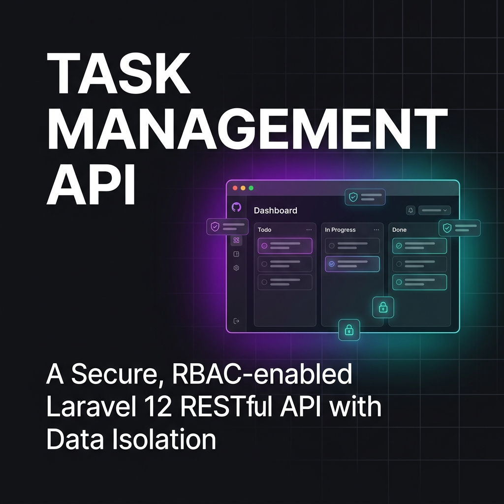

# Task Management Frontend SPA



Aplikasi klien Single Page Application (SPA) berbasis React 19 dan TypeScript strict mode yang mengonsumsi RESTful API sistem manajemen tugas. Dirancang dengan fokus pada responsivitas interaksi kanban, proteksi idempotensi transaksi, navigasi berbasis rute tipe statis, serta sistem desain token semantik mode terang dan gelap yang mematuhi standar aksesibilitas WCAG 2.1 AA.

---

## Ekosistem & Stack Teknologi

- **Library UI & Runtime:** React 19, ReactDOM 19
- **Bahasa & Compiler:** TypeScript 7 (Strict Mode, `noImplicitAny: true`)
- **Build Tool & Dev Server:** Vite 8
- **Navigasi & Routing:** TanStack Router (File-based routing & type-safe search params)
- **Server Cache & Data Fetching:** TanStack Query v5 (Optimistic UI mutations, invalidasi cache)
- **State Klien:** Zustand (Autentikasi sesi & preferensi tema)
- **Styling & Desain Token:** Tailwind CSS v4 (Direktif `@theme`, variabel CSS native, varian `@custom-variant dark`)
- **Komponen Ikon:** Lucide React
- **Drag & Drop:** `@dnd-kit/core`, `@dnd-kit/sortable`, `@dnd-kit/utilities`
- **Validasi Formulir:** React Hook Form & Zod
- **Klien HTTP:** Axios (Injeksi header `Authorization` Bearer token & generator `X-Idempotency-Key`)
- **Pemeriksaan Kualitas Kode:** Oxlint, Prettier, TypeScript Compiler (`tsc --noEmit`)

---

## Arsitektur & Pola Teknis Utama

### 1. Sistem Tema Semantik & Aksesibilitas
- Menggunakan CSS native custom properties yang dipetakan langsung ke direktif `@theme` pada `src/index.css`.
- Rasio kontras palet primer (`#4f46e5`) terhadap teks putih mencapai **6.36:1** (melebihi standar minimum WCAG 2.1 AA 4.5:1).
- Teks aksen mode gelap menggunakan saturasi `#818cf8` dengan rasio **5.23:1** terhadap permukaan `#0f172a`.
- Skrip blokir sinkron pada `<head>` di `index.html` mengeliminasi kedipan layar (*Flash of Unstyled Content*).
- Sinkronisasi event storage antar-tab peramban dan penyesuaian otomatis kontrol bawaan peramban via `color-scheme`.

### 2. Papan Kanban dengan Mutasi Optimistik
- Perubahan status kartu tugas (`todo` &rarr; `in_progress` &rarr; `done`) menerapkan mutasi cache visual instan melalui `useTaskStatusMutation`.
- Pembatalan perubahan (*rollback*) dieksekusi secara otomatis jika backend mengembalikan penolakan konkurensi (HTTP 409 atau 422).
- Kartu dengan status `done` dikunci dari aksi seret guna mematuhi aturan bisnis terminal backend.

### 3. Proteksi Idempotensi Transaksi
- Seluruh mutasi pembuatan entitas proyek dan tugas menyertakan header `X-Idempotency-Key` bernilai UUID v4 untuk mencegah duplikasi data akibat *network retry* atau pengiriman formulir ganda.

---

## Struktur Direktori

```text
frontend/
├── .github/
│   └── assets/                  → Aset visual dan banner dokumentasi
├── public/                      → Berkas statis publik (favicon, manifest)
├── src/
│   ├── api/                     → Klien Axios & kontrak endpoint backend
│   │   ├── client.ts            → Konfigurasi instance Axios & interceptor
│   │   └── endpoints/           → Fungsi pemanggil API per domain (auth, projects, tasks, comments)
│   ├── assets/                  → Ilustrasi dan grafis SVG
│   ├── components/              → Komponen antarmuka yang dapat digunakan kembali
│   │   ├── feedback/            → Komponen notifikasi & toast
│   │   └── ui/                  → Tombol, masukan formulir, modal, badge, toggle tema
│   ├── features/                → Modul bisnis terisolasi
│   │   ├── auth/                → Formulir & hooks autentikasi (lokal & OAuth)
│   │   ├── comments/            → Komponen linimasa & mutasi komentar tugas
│   │   ├── projects/            → Katalog, kartu proyek, dan dialog pembuatan proyek
│   │   └── tasks/               → Papan kanban, kartu tugas, dan detail modal
│   ├── routes/                  → Rute berbasis berkas TanStack Router
│   │   ├── __root.tsx           → Kerangka layout utama & bilah navigasi header
│   │   ├── index.tsx            → Halaman beranda
│   │   ├── login.tsx            → Halaman masuk
│   │   ├── register.tsx         → Halaman pendaftaran
│   │   ├── dashboard.tsx        → Dasbor ikhtisar statistik
│   │   ├── projects/            → Halaman katalog & detail proyek ($projectId.tsx)
│   │   └── oauth/               → Penanganan callback otentikasi pihak ketiga
│   ├── stores/                  → Global client state Zustand (authStore, themeStore)
│   ├── types/                   → Deklarasi tipe TypeScript (API, domain models)
│   ├── index.css                → Konfigurasi Tailwind v4 `@theme` & CSS tokens
│   ├── main.tsx                 → Titik masuk bootstrapping aplikasi React
│   └── routeTree.gen.ts         → Pohon rute otomatis hasil generasi TanStack Router
├── docs/                        → Spesifikasi dokumentasi arsitektur lokal
│   ├── registry/
│   │   └── COMPONENT_TOKENS.md  → Registri token desain & rasio kontras
│   ├── MODULE_BOUNDARY_MAP.md   → Peta batasan modul dan navigasi rute
│   ├── STATE_MANAGEMENT_MAP.md  → Peta aliran state server dan state klien
│   └── TASKS.md                 → Register backlog agenda tugas mendatang
├── .oxlintrc.json               → Konfigurasi linter statis Oxlint
├── .prettierrc                  → Konfigurasi formatting Prettier
├── .prettierignore              → Pengecualian berkas format (proteksi berkas markdown)
├── package.json                 → Manifes dependensi & skrip eksekusi
├── tsconfig.json                → Konfigurasi compiler TypeScript strict mode
└── vite.config.ts               → Konfigurasi bundler Vite & plugin
```

---

## Instalasi & Menjalankan Proyek

### 1. Kebutuhan Sistem
- Node.js versi 20.x atau 22.x LTS
- Package manager `npm`

### 2. Persiapan Lingkungan
Salin berkas konfigurasi lingkungan lokal dari contoh template:

```bash
cp .env.example .env
```

Pastikan variabel `VITE_API_BASE_URL` mengarah ke endpoint backend aktif:

```env
VITE_API_BASE_URL=http://localhost:8000/api
```

### 3. Instalasi Dependensi

```bash
npm ci
```

### 4. Menjalankan Server Pengembangan

```bash
npm run dev
```

Aplikasi dapat diakses melalui peramban pada alamat `http://localhost:5173`.

---

## Perintah Skrip yang Tersedia

| Baris Perintah | Deskripsi Fungsional |
| :--- | :--- |
| `npm run dev` | Menjalankan server pengembangan lokal Vite dengan HMR. |
| `npm run build` | Menjalankan kompilasi TypeScript (`tsc -b`) dan bundel aset produksi Vite. |
| `npm run typecheck` | Memvalidasi kepatuhan tipe TypeScript tanpa menghasilkan berkas emisi (`tsc --noEmit`). |
| `npm run lint` | Menjalankan analisis statis kode menggunakan linter Oxlint. |
| `npm run format:check` | Memeriksa kepatuhan pemformatan kode melalui Prettier tanpa mengubah berkas. |
| `npm run format` | Memformat kode sumber secara otomatis sesuai aturan `.prettierrc`. |
| `npm run check` | Menjalankan rangkaian verifikasi terpadu (typecheck, lint, dan format:check). |
| `npm run preview` | Menjalankan server lokal untuk pratinjau hasil kompilasi produksi di folder `dist`. |

---

## Standar Mutu & Analisis Kualitas Kode

Proyek ini menerapkan standar mutu berlapis untuk memastikan keandalan kode sebelum digabungkan ke cabang utama:

1. **Strict Type Safety:** Seluruh kode wajib memiliki deklarasi tipe eksplisit tanpa penggunaan tipe `any`. Kompilasi diverifikasi melalui `npm run typecheck`.
2. **Static Analysis & Linting:** Konfigurasi `.oxlintrc.json` menegakkan aturan hooks React (`react/rules-of-hooks`), pencegahan kesalahan rendering list (`react/jsx-key`), dan larangan tipe longgar (`typescript/no-explicit-any`).
3. **Format Standard:** Format indentasi, tanda petik tunggal, dan lebar baris distandarkan melalui `.prettierrc`. Berkas dokumentasi markdown (`*.md`) dikecualikan secara ketat pada `.prettierignore` guna mencegah rusaknya format spesifikasi teks.
